# AS-IS dos processos-piloto (reconstruído do SEI)

Gerado por `scripts/asis_piloto.py`. Horas = modelo por conteúdo (laudas autorais × complexidade + leitura de insumos + fontes externas), hipótese a calibrar. du = dias úteis. Nos fluxos, cada caixa é uma passagem em que a unidade juntou documento; vermelho = espera dominante (≥ 20 du com trabalho < 5% da capacidade); amarelo = a peça registra sinal de perda (complementação, diligência, prazo, reiteração).

## P06 — Fiscalização técnica de campo (programada e por demanda)

| Processo SEI | Caso | Lead time (du) | Documentos | Laudas produzidas | Horas (modelo) | Eficiência do ciclo | Tempo em espera dominante |
|---|---|---|---|---|---|---|---|
| SEI-480002/001314/2024 | designado | 636 | 75 | 336 | 478 | 12.5% | 89% |

**Onde está o trabalho:** Fiscalização de campo 92%; Análise jurídica 3%; Análise técnica de engenharia 3%; Comunicação 2%; Encaminhamento 0%.
**Competências exigidas (por horas):** Engenharia de saneamento (intermediário); Auditoria e controle (intermediário); Jurídico-regulatória (especialista); Ambiental (básico); Redação oficial (básico); Gestão processual (básico).
**Insumos:** vistoria ou campo (41); norma ou contrato (24); documento do processo (18); documento da regulada (16); base externa (5); sistema ou base interna (1).
**Ferramentas e técnicas mais usadas:** vistoria in loco (12); vistoria in loco com checklist (anexo) (3); vistoria in loco com relatório fotográfico (3); vistoria in loco com checklist de estação elevatória (3); vistoria in loco com checklist do anexo (2); registro fotográfico da estação (2).
**Exemplos de cálculo:** Potência em operação: 3 motores de 150 cv, totalizando 450 cv, de 600 cv instalados; Balanço de vazões apresentado pelo autor  água bruta mais água de barragem igual a água tratada : 20,28 l/s e….
**Sinais de perda nas peças:** pedido de complementação (10); reiteração (4); prazo concedido (1).

### SEI-480002/001314/2024 — caso designado

nan

```mermaid
flowchart LR
  t0["CASAN<br/>Fiscalizar estação de captação em tempo seco<br/>447.7 h · 68 du"]
  class t0 perda
  t1["SCEXEC<br/>Manifestação 55<br/>0.5 h · 55 du"]
  class t1 espera
  t2["CASAN<br/>analisar respostas da concessionária às fiscalizações de 20…<br/>13.0 h · 0 du"]
  class t2 perda
  t3["CASAN<br/>Rebater argumento da concessionária sobre fiscalização<br/>2.3 h · 2 du"]
  class t3 perda
  t4["SCEXEC<br/>Encaminhar manifestação da regulada à CASAN<br/>0.1 h · 0 du"]
  t5["SCEXEC<br/>encaminhar autos à Procuradoria para análise jurídica<br/>0.4 h · 2 du"]
  t6["PROC<br/>Analisar fundamentos jurídicos da fiscalização<br/>12.7 h · 203 du"]
  class t6 espera
  t7["SCEXEC<br/>dar ciência do parecer à concessionária<br/>1.0 h · 0 du"]
  t0 --> t1
  t1 --> t2
  t2 --> t3
  t3 --> t4
  t4 --> t5
  t5 --> t6
  t6 --> t7
  classDef espera fill:#f8d7da,stroke:#b02a37
  classDef perda fill:#fff3cd,stroke:#b58105
```

