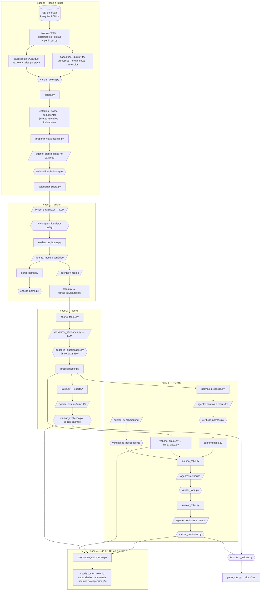

# Visão geral da metodologia

Este conjunto de documentos descreve como mapear, avaliar e redesenhar os processos de uma agência
reguladora **a partir do registro do SEI**, e não de entrevistas. Foi escrito para ser seguido por um
agente de IA (Claude Code, Codex ou equivalente) que vai replicar o método em outro órgão. Cada capítulo
diz o que fazer, em que ordem, com que regra, como verificar e quando parar.

O caso de referência é a AGENERSA (RJ). Todas as saídas reais desse caso estão em [`saida/`](../../saida/)
e os relatórios em [`docs/`](../). Use-as como exemplo resolvido: formato dos arquivos, ordem de grandeza dos
números e tipo de achado.

## 1. Ideia central

O mapeamento tradicional pergunta ao servidor como o processo funciona. Aqui a ordem é invertida:

1. **Reconstruir** o processo real a partir do que o SEI registrou: quem juntou cada documento, quando o
   processo entrou e saiu de cada unidade, o que cada peça diz e quanto trabalho ela contém.
2. **Medir** tempo, espera, esforço, retrabalho e conformidade legal com código reprodutível.
3. **Só então** levar o resultado aos servidores, para **validar e calibrar**: confirmar nomes de
   atividades, variantes e decisões e medir o tempo real de algumas peças-tipo. A entrevista deixa de ser
   descrição do zero e passa a ser conferência.

Três consequências práticas:

- Todo número sai de um script que qualquer um pode rodar de novo. Nada é digitado à mão em planilha ou texto.
- O que é estimativa fica marcado como estimativa. **Horas de trabalho e custo são hipótese até a calibração
  com servidores**, e o texto dos entregáveis tem de dizer isso.
- O mapa cobre o que passa pelo SEI. O que acontece fora dele (telefonema, reunião sem ata, planilha
  paralela) não aparece, e isso é um limite declarado, não um defeito escondido.

## 2. As fases

| Fase | Pergunta | O que produz | Capítulos |
|---|---|---|---|
| 0. Base e trilhas | Por onde o processo passou, quanto tempo ficou em cada lugar, com quem estava? | Tabelas canônicas do SEI, estadias, posse, documentos atribuídos, indicadores por processo, classificação de cada processo SEI no catálogo de processos organizacionais, seleção do piloto | [01](01_COLETA_E_BASE.md), [02](02_TRILHA_TEMPO_POSSE.md), [04](04_CLASSIFICACAO_COORTE.md) |
| 1. Piloto de conteúdo | O que cada peça fez e quanto trabalho ela contém? Como é o fluxo de um tipo de processo? | Ficha de trabalho por peça, esforço em faixa (piso–teto), modelo BPMN canônico de cada tipo do piloto, vínculos atividade → peças, linha do tempo e tabela de fatos, avaliação AS-IS | [03](03_CONTEUDO_ESFORCO.md), [05](05_MODELAGEM_BPMN.md), [06](06_AVALIACAO_ASIS.md) |
| 2. Do caso ao procedimento | O fluxo de dois casos vale para o tipo de demanda? | Coorte por tipo, classificador de atividade auditado às cegas, distribuições por atividade (mediana, quartis, n), caminhos, transições, BPMN com percentuais da coorte, avaliação pela coorte | [04](04_CLASSIFICACAO_COORTE.md), [05](05_MODELAGEM_BPMN.md), [06](06_AVALIACAO_ASIS.md) |
| 3. Do AS-IS ao TO-BE | O que a lei exige, quanto o processo cumpre, o que funciona em outros lugares e quanto se ganha mudando? | Base normativa com trecho literal verificado, requisitos com teste computável, conformidade medida, linha de base congelada, benchmarking verificado, melhorias em três fases cumulativas simuladas em três cenários, controles, indicadores e metas | [07](07_CONFORMIDADE_LEGAL.md), [08](08_BENCHMARKING.md), [09](09_TOBE_SIMULACAO.md), [10](10_CONTROLES_METAS.md) |
| 4. Do TO-BE ao sistema | Que tipo de processo serve de piloto para um sistema de IA que o automatize por inteiro, e quanto custa e retorna? | Matriz de priorização (volume, foco em análise, dados estruturados e não estruturados, regras claras, padronização, completude), portões do piloto, custo × retorno em três cenários, capacidades de IA transversais e insumos para especificar o sistema | [11](11_PRIORIZACAO_AUTOMACAO.md) |

As três fases de melhoria do TO-BE são cumulativas: **fase 1** ajusta o fluxo sem tecnologia nova; **fase 2**
automatiza regras e dados; **fase 3** usa IA (extração, avaliação assistida, minuta) sempre com revisão
humana. A camada de **controles, indicadores e metas** acompanha as três (no benchmarking ela aparece como
"fase 4" das melhorias, que não é a fase 4 do método).

## 3. Três tipos de etapa

Toda etapa do método é de um destes três tipos. Saber o tipo diz como executá-la e como confiar nela.

| Tipo | Quem faz | Exemplos | Como se confia |
|---|---|---|---|
| **Determinística** | Script em [`scripts/`](../../scripts/) | Trilha e posse, linha do tempo, fatos, procedimento da coorte, conformidade, simulação do TO-BE, geração do BPMN e do site | Testes sintéticos de cada regra ([`tests/test_regras.py`](../../tests/test_regras.py)) e testes de propriedades das saídas ([`tests/test_saidas.py`](../../tests/test_saidas.py)) |
| **Julgamento por agente com especificação** | LLM ou agente, seguindo um arquivo `ESPECIFICACAO_*.md` escrito **antes** | Ficha de trabalho por peça, classificação no catálogo, modelo canônico, vínculos, rótulo de atividade, avaliação AS-IS, curadoria de normas, benchmarking, melhorias, controles | Saída em JSON com esquema fixo; tudo o que é número ou citação é conferido por código; amostra auditada às cegas |
| **Verificação** | Portão (script que não gera nada e barra a sequência) ou auditor independente às cegas | `validar_avaliacao.py`, `verificar_normas.py`, `validar_tobe.py`, `validar_controles.py`, `auditoria_classificador.py`, reclassificação cega, verificação de benchmark | Critério de aceite fixado antes (ex.: concordância ≥ 85%, alucinação ≤ 2%); falha para o pipeline |

Regra geral: **o agente escreve nomes, fluxo, decisões, descrições e propostas; o código escreve os números.**
Quando o agente precisa citar um número, cita o identificador de um fato calculado, e o validador confere.

## 4. Fluxo de artefatos



Legenda: retângulo = script determinístico; paralelogramo = julgamento por LLM ou agente; hexágono = portão
ou verificação.

## 5. Como rodar

As etapas determinísticas estão encadeadas em [`scripts/pipeline.py`](../../scripts/pipeline.py), que roda de
dentro de `scripts/`, em ordem fixa, e **para no primeiro portão que falhar**:

```
cd scripts
python pipeline.py                 # testes das regras → trilha → … → site
python pipeline.py --fichas        # inclui as fichas de trabalho por LLM
python pipeline.py --de fatos      # retoma de uma etapa
python pipeline.py --sem-site      # para antes do site
python -m pytest ../tests          # todos os testes
```

As etapas de agente (classificação, modelo, vínculos, rótulos de auditoria, avaliação, normas, benchmarking,
melhorias, controles) ficam fora do pipeline e são chamadas à parte, cada uma com sua especificação. A coleta também
fica fora (`python -m coleta.*`, da raiz do repositório). Num órgão novo, enquanto não existem a base normativa e os
arquivos da fase 3, essas etapas saem com `aviso:` e o pipeline segue; `--ate <etapa>` para numa etapa. Na primeira
vez, siga a ordem do [ROTEIRO_REPLICACAO.md](ROTEIRO_REPLICACAO.md), etapa por etapa. O pipeline
registra cada execução em `saida/pipeline_execucao.json` (etapas, duração, commit, impressão digital dos fatos)
e usa uma trava para impedir duas execuções simultâneas.

## 6. Mapa dos documentos

| Documento | Para quê |
|---|---|
| [01_COLETA_E_BASE.md](01_COLETA_E_BASE.md) | Obter as tabelas canônicas e o conteúdo das peças; perfis do SEI e do órgão |
| [02_TRILHA_TEMPO_POSSE.md](02_TRILHA_TEMPO_POSSE.md) | Estadia, posse, linha do tempo, terceiros, dias úteis |
| [03_CONTEUDO_ESFORCO.md](03_CONTEUDO_ESFORCO.md) | Ficha de trabalho por peça, autoria, esforço piso × teto |
| [04_CLASSIFICACAO_COORTE.md](04_CLASSIFICACAO_COORTE.md) | Catálogo, classificação, piloto, coorte |
| [05_MODELAGEM_BPMN.md](05_MODELAGEM_BPMN.md) | Modelo canônico, vínculos, classificador de atividade, procedimento |
| [06_AVALIACAO_ASIS.md](06_AVALIACAO_ASIS.md) | Tabela de fatos, avaliação Lean/IA, validador, carimbo |
| [07_CONFORMIDADE_LEGAL.md](07_CONFORMIDADE_LEGAL.md) | Normas com trecho literal, requisitos testáveis, conformidade |
| [08_BENCHMARKING.md](08_BENCHMARKING.md) | Casos de referência com fonte verificável |
| [09_TOBE_SIMULACAO.md](09_TOBE_SIMULACAO.md) | Melhorias em fases, efeitos, cenários, sensibilidade |
| [10_CONTROLES_METAS.md](10_CONTROLES_METAS.md) | Indicadores, metas com origem, controles de qualidade da IA |
| [11_PRIORIZACAO_AUTOMACAO.md](11_PRIORIZACAO_AUTOMACAO.md) | Matriz de priorização da automação, custo × retorno, do piloto à especificação do sistema |
| [BOAS_PRATICAS.md](BOAS_PRATICAS.md) | Princípios transversais e como o código os impõe |
| [VERIFICACAO_IA.md](VERIFICACAO_IA.md) | Tudo que a IA produziu, como foi verificado e o que falta |
| [DADOS_LEVANTADOS.md](DADOS_LEVANTADOS.md) | Inventário dos dados da melhoria, fonte, confiança, o que obter no órgão |
| [ROTEIRO_REPLICACAO.md](ROTEIRO_REPLICACAO.md) | Checklist do clone ao TO-BE e à priorização da automação, com paradas para validação humana |

Documentos de método e resultado do caso, para consulta: [METODO.md](../METODO.md),
[AUDITORIA.md](../AUDITORIA.md), [MITIGACOES.md](../MITIGACOES.md),
[PLANO_AUDITORIA_E_AMPLIACAO.md](../PLANO_AUDITORIA_E_AMPLIACAO.md), [RESULTADOS_FASE0.md](../RESULTADOS_FASE0.md),
[RESULTADOS_PILOTO.md](../RESULTADOS_PILOTO.md), [RESULTADOS_FASE2.md](../RESULTADOS_FASE2.md),
[BPMN_PILOTO.md](../BPMN_PILOTO.md), [AVALIACAO_ASIS.md](../AVALIACAO_ASIS.md), [BENCHMARKING.md](../BENCHMARKING.md).

## 7. Ordem de grandeza do caso AGENERSA

| Item | Valor | Origem |
|---|---|---|
| Processos SEI na base | 251 (172 nativos do SEI, 79 físicos migrados) | [RESULTADOS_FASE0.md](../RESULTADOS_FASE0.md) |
| Andamentos lidos / documentos atribuídos | 19.095 / 12.986 | idem |
| Processos-piloto (fase 1) | 12, em 8 processos organizacionais | [RESULTADOS_PILOTO.md](../RESULTADOS_PILOTO.md) |
| Coorte da fase 2 | 117 processos; fichas de 3.183 peças | [RESULTADOS_FASE2.md](../RESULTADOS_FASE2.md) |
| Atividades avaliadas | 160, em 13 processos | [AVALIACAO_ASIS.md](../AVALIACAO_ASIS.md) |
| Processos com TO-BE completo | 3 (reajuste tarifário, fiscalização de campo, ocorrência de usuário) | `saida/fase3/resultado_tobe_*.json` |
| Casos de benchmarking verificados | 64 (51 sem ressalva, 13 corrigidos, 0 excluídos) | [BENCHMARKING.md](../BENCHMARKING.md) |

O achado que se repetiu em todos os processos: **o tempo é espera, não trabalho**. No piloto, mesmo com o
esforço no teto, a eficiência do ciclo mediana ficou em 3,4% e 80% do tempo de posse foi espera dominante
([RESULTADOS_PILOTO.md](../RESULTADOS_PILOTO.md)). É por isso que a fase 1 do TO-BE (ajuste do fluxo) costuma
render mais em lead time do que a IA, que reduz sobretudo horas.
